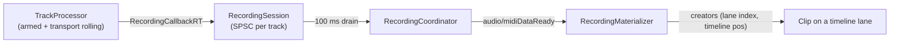
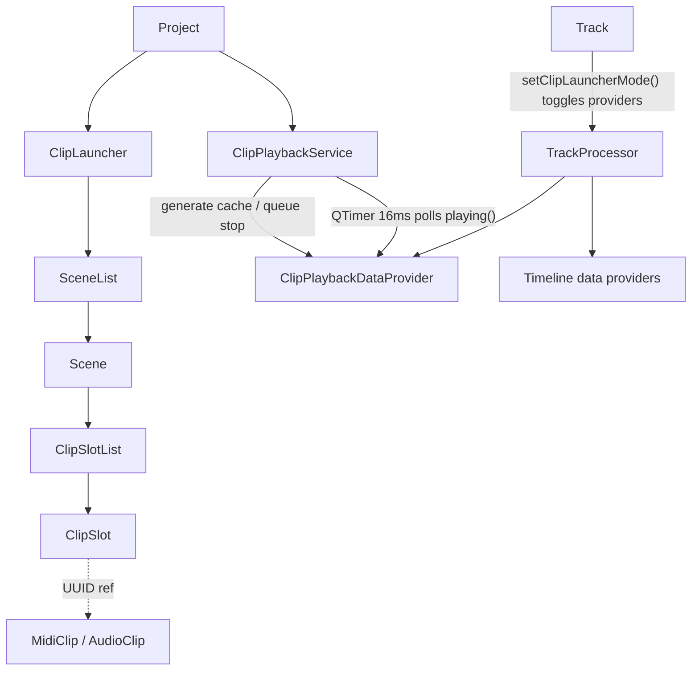

<!---
SPDX-FileCopyrightText: © 2026 Hannes Janetzek <hannes.janetzek@gmail.com>
SPDX-License-Identifier: CC-BY-SA-4.0
-->

# Zrythm Development & Investigation Notes

Running log of investigations and development work. Newest entries on top.

Build: Debug via Conan `gcc_debug` profile → `conanbuild/Debug`
(see [Build setup](#build-setup-2026-10-31) at the bottom).

---

## Recording into Clip Launcher Slots: What's Missing (2026-10-31)

Recording into slots is not implemented at all. The recording pipeline
itself is solid and already handles **both audio and MIDI**, so most of
the work is giving it a second destination (a clip slot) besides
timeline lanes.

`doc/dev/recording_architecture.md` is out of date: it describes only
audio and lists MIDI as an extension, but the code has
`RecordingMidiPacket` and `RecordingMaterializer::on_midi_data_ready`
(notes, control events, chord clips).

### How recording works today

- Capture happens in `TrackProcessor::custom_process_block` when the
  transport is rolling, preroll is done, and the track is armed
  (`track_processor.cpp:872`). The clip launcher mode is not checked.
- Packets carry the timeline position and a `transport_recording` flag.
  The materializer **drops packets unless `transport_recording` is set**
  (`recording_materializer.cpp:62`, `:306`), i.e. unless the global
  record button is on.
- The materializer creates clips only on lanes, at timeline positions,
  through the creator callbacks wired in `project_session.cpp:347`. It
  opens a new take on any discontinuity, such as a transport loop.
- One undo macro covers each take; it closes on
  `RecordingCoordinator::recordingSessionEnded`, i.e. when the transport
  stops.

### Workflow for now: drag timeline clips into slots (done 2026-10-31)

Record onto the timeline, then drag the recorded clip from the timeline
onto a clip slot (or onto the phantom column to create a scene). The
slot receives a copy that starts at position 0; the timeline clip stays
where it was.

- The arranger moves clips with its own pointer handling, not Qt
  drag-and-drop. While a clip move leaves the arranger, an
  `ArrangerClipDragItem` (an internal drag carrying the clip) follows
  the pointer.
- Drop targets mark themselves with `acceptsArrangerClips`. On release
  the arranger drops only onto such a target, and then cancels its own
  move. This guard matters because several `DropArea`s (tracklist,
  plugin slots, tab buttons) have no `keys` and would accept any drag.
- `ArrangerObjectCreator::copyClipToClipSlot` clones the clip and
  attaches it with `AddClipToClipSlotCommand` (undoable, replaces the
  slot's clip). `canCopyClipToClipSlot` limits MIDI clips to
  MIDI/instrument tracks and audio clips to audio tracks; slots of other
  tracks reject the drag.
- Scene creation from the phantom column is still not undoable (22).

### Gaps for slot recording

1. **No way to start it.** `ClipSlot::ClipState` has no recording states
   (`RecordQueued`/`Recording`), the service has no `recordIntoSlot`, and
   `ClipLaunchButton` offers only play and stop. A record button on
   empty slots of armed tracks is the usual UI.
2. **No destination selection.** The materializer needs a per-track
   target: "slot X, window [start, end)". Clip-relative positions would
   start at the quantized start sample, and the clip would be attached
   with `AddClipToClipSlotCommand` instead of a lane add. Today the
   creator callbacks are lane-only.
3. **Gating on the global record button.** Slot recording must keep
   packets inside its window even when `transport_recording` is false,
   and timeline recording must not also record them.
4. **Quantized start and stop.** The start and end samples need to be
   computed from the launch quantization (next bar/beat, from the
   `TempoMap`), with optional fixed lengths (1, 2, 4 bars …). Trimming
   to the window is exact because packets carry timeline positions.
5. **Transport loop and seeks.** A jump backwards currently starts a new
   take. Slot recording should end, or ignore the packets, rather than
   create a second clip.
6. **Finishing.** Set the clip length and loop points to the recorded
   (quantized) length, close the undo macro per slot recording rather
   than on transport stop, and optionally hand over to playback at the
   end boundary. The queued-launch mechanism added for clip switching can
   start the new clip on exactly that sample.
7. **Monitoring and the playing clip.** Input monitoring already works
   (`MonitorMode::Auto` while armed), but a clip playing on the same
   track would sound together with the input. It should stop, or be
   replaced, when recording starts.
8. **MIDI specifics.** Notes held at the end of the window need note-offs
   at the clip end (`force_complete_pending_notes` exists). Overdubbing
   into an existing MIDI clip is a separate, later feature.
9. **Tests.** `tests/integration/audio_recording_pipeline_test.cpp` is
   the model for an end-to-end slot recording test.

Rough order: 3 + 2 in the materializer (a destination abstraction), then
4 and 6 in the service with the new slot states, then UI (1), then 5, 7
and 8.

### Implemented (2026-10-31)

- **Backend (2, 3, 5, 8):** `RecordingMaterializer::begin_clip_slot_recording`
  / `end_clip_slot_recording` record a track into a slot within a timeline
  window. Packets are trimmed to the window regardless of the transport's
  record button. The track's timeline recording is suspended while it
  runs. A gap (transport loop, seek), the window end, or the session end
  finishes the recording, completing held notes. Clip slot recordings stay
  out of the "Record" macro; attaching the clip is a single undoable
  `AddClipToClipSlotCommand`.
- **Finishing (6):** the clip moves to position 0, its length is the
  recorded window, and its loop covers it. **Playback handoff (done
  2026-11-01):** a recording that ends at its requested end while the
  transport rolls continues straight into playback through an aligned
  launch (`ClipPlaybackService::launch_clip_aligned`). It switches
  immediately but anchors the clip start at the end position, because the
  clip is only complete ~100 ms later, after the last drain. Recordings
  ended by a transport stop, loop or disarm don't auto-play.
- **Controller (4, 7):** `controllers::ClipSlotRecorder`, exposed as
  `ProjectSession.clipSlotRecorder`:
  - starts and stops at the clip launcher's launch quantization
    (`next_quantization_tick`, tested incl. 7/8);
  - starts the transport if it is stopped;
  - stops the track's playing clip at the same quantization point;
  - moves the slot through RecordQueued → Recording → Stopped.

  **Fixed lengths (done 2026-11-01):** a "Recording Length" combo box
  (Free/1/2/4/8 bars) sets `ClipSlotRecorder::fixedLengthBars`. It's kept
  for the session only, not saved in the project.
- **UI (1):** empty slots of armed tracks show a red "●" button; it blinks
  while queued and turns into "■" (stop) while recording.
- **Tests (9):** 9 materializer unit tests and 4 quantization tests. **No
  end-to-end integration test yet.**

---

## Clip Launcher: State of the Implementation (2026-10-31)

Snapshot at `1d50dc9d4` (v2.0.0-alpha.7). Based on reading the code and
running the existing unit tests (all 110 matching clip-launcher tests pass).
Items marked **(verified by reading)** are inferred from the code, not
reproduced in a test yet.

### Summary

The clip launcher is an **early prototype**: the data model, project
serialization, a basic grid UI and a working MIDI/audio playback path exist,
but quantization, stop handling, clip switching and most UI controls are
incomplete. The core playback logic was last changed substantially in
2025; since then it has mostly been touched by project-wide refactors
(Region→Clip rename, registry, pimpl).

| Area | Status |
|------|--------|
| Data model (ClipLauncher → Scene → ClipSlot) | Done, tested |
| Serialization (project JSON) | Done, tested (roundtrip + validation) |
| Track ↔ slot sync (track add/move/remove) | Done (`ClipSlotList` listens to `TrackCollection`) |
| Playback engine (`ClipPlaybackDataProvider`) | Works for basic loop playback; several bugs/gaps |
| Launch quantization | Only Immediate / NextBar / NextBeat; offset bug |
| Stop quantization | **Not implemented** (stops immediately) |
| Playback service / state machine | Basic; switching clips on a track is broken |
| UI grid | Present; several buttons unwired, debug placeholders |
| Undo/redo | Only "add clip to slot" via file import |
| Docs | `doc/dev/scenes_architecture.md` describes the intended design, partly ahead of the code |

### Architecture (as implemented)

Key files:

- Model: `src/structure/scenes/{clip_launcher,scene,clip_slot}.{h,cpp}`
- Service: `src/structure/scenes/clip_playback_service.{h,cpp}`
- RT playback: `src/structure/tracks/clip_playback_data_provider.{h,cpp}`
- Mode switch: `Track::setClipLauncherMode` (`src/structure/tracks/track.cpp:536`)
- Processor hook: `TrackProcessor::fill_midi_events` / `fill_audio_events`
  (`src/structure/tracks/track_processor.cpp:660`, `:691`)
- UI: `src/gui/qml/components/{ClipLauncherView,ClipSlotView,ClipLaunchButton}.qml`,
  shown from `CenterDock.qml` when `tracklistHeader.clipLauncherVisible`
- Undo: `src/commands/add_clip_to_clip_slot_command.h`
- Quantize enum: `ClipQuantizeOption` in `src/structure/tracks/track_fwd.h:84`

### What works

- One scene grid, rows = tracks (pinned/unpinned sections), columns = scenes,
  plus a "phantom" column that creates a scene on drop/double-tap.
- Dropping an audio/MIDI file on a slot imports it (undoable via
  `AddClipToClipSlotCommand`).
- Launch a clip / a whole scene; MIDI and audio clips loop over the clip
  length; all-notes-off is sent when a MIDI clip stops.
- Launching switches the track's processor from timeline providers to the
  clip launcher provider; the per-track "Switch Playback to Timeline"
  button switches back.
- Playback position indicator in the slot (polls the service at 60 fps).

### Bugs / gaps found

**Playback engine (`clip_playback_data_provider.cpp`)**

1. **Stop ignores quantization.** `queue_stop_playback()` clears the
   buffers immediately; the code says so in a comment ("In a full
   implementation, this would respect the quantization option").
   **Fixed:** a quantized stop is queued as a switch to silence and takes
   effect at the quantization point. A launch issued before then replaces
   it, and cancelling it keeps the clip playing.
2. **Quantized start lands at the block start, not on the bar or beat**
   **(verified by reading)**. `handle_quantization_and_start()` computes
   `output_buffer_timestamp_offset` (where the boundary falls inside the
   block) but only returns `{start_offset, samples_to_process}`; the
   caller then passes `time_nfo.buffer_offset_` to
   `process_chunks_with_looping`. When a bar or beat boundary falls inside
   a block, playback starts up to one block early and the clip's timing is
   off by that much from then on. The tests only cover boundaries that are
   exactly at a block start (`QuantizationTimingAccuracy`), so they don't
   catch this.
   **Fixed** on branch `clip-launcher-fixes`: the start is now
   sample-accurate, and a boundary exactly at the block end starts in the
   next block. New `QuantizedStart*` tests failed before the fix and pass
   after it.
3. **Only Immediate, NextBar and NextBeat are implemented.**
   `NextQuarterBeat`…`NextThirtySecondBeat` fall into `default:` and start
   immediately. **Fixed:** decided on note values (1/4 … 1/32 notes, like
   Ableton and Bitwig) and renamed the options to
   `NextQuarterNote`…`NextThirtySecondNote`. The grid counts from the
   start of the bar and is capped at the next bar start.
4. **Switching clips on a playing track skips quantization and the
   restart (verified by reading).** `playing_` stays `true` when a new
   cache is installed, so the quantization branch is skipped: the new clip
   starts immediately, at the old clip's position, and wraps at the new
   clip's length. **Fixed:** the provider has two cache slots and an atomic
   slot state. A launched clip waits in the idle slot, and the audio thread
   switches to it at the quantization point, silencing MIDI notes of the
   old clip there. A newer launch replaces a queued clip, and a stop
   discards it. See "Switching Clips on a Track" in
   `doc/dev/scenes_architecture.md`.
5. **Looping ignores the clip's loop points.** The loop end is the clip
   length (`end_position_ = clip.length()`), and the loop always wraps to
   0. The clip-start, loop-start and loop-end markers are not used (see
   "Looping Behavior" in AGENTS.md). Whether
   `ClipRenderer::serialize_to_sequence` already applies the loop for MIDI
   is still to be checked.
   **Checked:** `ClipRenderer` does apply clip start and loops, but over
   the clip's *length*, as the clip plays on the timeline
   (`for_each_loop_segment(clip_start, loop_start, loop_end,
   clip_length)`). The launcher then wraps that rendering back to 0. It
   only differs from the expected launcher behaviour (clip start → loop
   end, then loop start → loop end forever, length ignored) when the
   markers are moved or the length isn't "clip start + n loops".
   - **MIDI fix (contained):** render with playback length
     `intro + loop_length`, where `intro = loop_end - clip_start` (so one
     full loop always follows the intro, also when the clip start is
     after the loop start), and wrap to `intro` instead of 0. This needs a
     length parameter on `serialize_to_sequence`.
   - **Audio (bigger):** `serialize_to_buffer` is tied to the clip's
     timeline placement. It uses the tempo at the clip position, the
     warp map relative to the clip start tick, `native_clip_len` from
     the length, and fades at the clip boundaries. A launcher rendering
     needs a position-independent variant, and a decision on fades at
     loop wraps (probably only a short declick).
   **MIDI fixed** (you chose MIDI loop and tempo first; audio stays open):
   launched MIDI clips play clip start → loop end, then loop start → loop
   end forever. `ClipRenderer::serialize_to_sequence` gained a
   `playback_length` parameter. Found and fixed along the way: a
   note-off exactly on the loop end was dropped (hanging notes), and on
   every wrap the intro's note-offs at the loop start were replayed.
6. **Tempo handling.** MIDI event times are converted with
   `tick_to_samples_rounded` at timeline ticks counted from 0, i.e. using
   the tempo at the start of the project rather than at the launch
   position. A tempo change partway through a clip, or a launch after a
   tempo change, gives wrong event timing (verified by reading). The loop
   length is converted the same way.
   **Proposed fix:** keep MIDI events in ticks in the cache and convert on
   the audio thread relative to the launch:
   `tick_to_samples(launch_tick + event_tick) - launch_sample`. Loop
   wraps would be tracked in ticks too. This changes how the provider
   tracks position (ticks instead of samples), so it fits together with
   the MIDI part of 5. Audio follows tempo only through warping, which is
   part of the audio rendering question above.
   **MIDI fixed:** the cache stores events in ticks. The playback position
   advances in ticks (resyncing to the transport when it moves, and
   running freely while it is stopped), and event sample offsets come from
   the tempo map. The slot's position indicator now uses
   `current_playback_fraction()`, the position as the clip shows it.
7. **Seeking before the launch point (verified by reading).**
   `update_playback_position` computes
   `(current - launch) % loop_end`. If the playhead moves before the
   launch position, the result is negative and is used as a buffer
   offset. The tests `BackwardPlayheadMovement*` exist, but they need
   checking for this case. **Fixed in code** (the result is wrapped into
   `[0, loop end)`), but there's no dedicated test yet.
8. The playhead position is recalculated on every block, because
   `last_seen_timeline_position_` stores the block start, so it never
   equals the next block's start while rolling. This is harmless but
   wasteful. Behaviour while the transport is stopped hasn't been checked.

**Playback service (`clip_playback_service.cpp`)**

9. **Launching clip B on a track while clip A plays leaves A showing
   `Playing`.** `playing_clips_[track]` is overwritten and A's state is
   never reset. The new monitor also sees `playing() == true` right away
   and marks B `Playing` before its quantization point (see 4).
   **Fixed:** the service tracks a playing and a queued slot per track. B
   stays `PlayQueued` until the provider reports the switch, and only then
   does A become `Stopped`. Stopping a queued clip discards it and keeps A
   playing.
10. **The QTimer is destroyed inside its own `timeout` handler.** The
    monitor erases its own map entry, which owns the `QObjectUniquePtr<QTimer>`.
    It should use `deleteLater()` or stop the timer and defer the cleanup.
    **Fixed:** there's now one shared monitor timer. It also replaces the
    `checkPlaybackState()` stub (12).
11. Raw `ClipSlot *` and `Track *` pointers are kept in
    `playing_clips_` and in the timer lambdas. Removing a scene or track
    while a clip plays leaves them dangling. They should be UUID
    references. **Fixed:** removing a scene or track deletes its slots
    (the registry deletes an object when its last reference goes), so the
    service now listens to each tracked slot's `destroyed` signal and
    forgets it, stopping or cancelling its playback. Track lookups go
    through `trackIfPresent`, because `track_ref_at_id` throws for removed
    tracks. Track removal also triggers a state check. UUID references
    were not used, because they would keep removed slots alive.
12. `checkPlaybackState()` is an empty stub, and
    `cancelPendingClipOperations` resets only queued clips, not playing
    ones. **Partly fixed:** `setTrackToTimelineMode` now stops a playing
    clip and resets its slot. The `checkPlaybackState()` stub is still
    there.
13. `launchClip` defaults to `NextBar` and `stopClip` to `NextBar`, but
    a stop is immediate anyway (see 1), so the UI's "queued" state for a
    stop lasts only one timer tick. **Resolved with 1:** UI stops now wait
    for the next bar.

**UI (`ClipLauncherView.qml` and related QML)**

14. The per-track **stop buttons** (`TrackStopButtonListView`) have no
    `onClicked`. **Fixed:** they call the new
    `ClipPlaybackService::stopTrackClips`.
15. The header's global **"Switch Playback to Timeline"** button has no
    `onClicked`. **Fixed:** it calls the new
    `ClipPlaybackService::setAllTracksToTimelineMode`.
16. Scene headers show a hardcoded `"Scene " + (index + 1)` and ignore
    `scene.name` and `scene.color`. There's no UI to rename, delete,
    reorder or color scenes, although the model supports
    `removeScene`/`moveScene`. **Partly fixed:** headers show
    `scene.name`, falling back to a translatable "Scene N". **Fixed:**
    right-clicking (or long-pressing) a scene header opens a menu with
    Rename, Color, Insert Before, Move Left/Right, Stop and Delete. The
    scene color shows as a strip under the header, and "+" adds a scene.
    Reordering is by menu; there's no drag reordering yet.
17. Double-tapping an empty slot creates a MIDI clip with **two
    hardcoded test notes** (pitches 64 and 68) and logs to the console.
    This is debug code, and it bypasses undo
    (`addEmptyMidiClipToClip` calls `setClip` directly). **Fixed:** the
    clip is now created empty, through the undo stack, and only in an
    empty slot. The debug `console.log` calls are removed.
18. The quantize menu offers only Immediate, Bar and Beat. There's no
    global or per-clip default launch quantization setting. **Partly
    fixed:** the menu now also offers the 1/4–1/32 note options.
    **Fixed:** `ClipLauncher::launchQuantization` is a project setting
    (saved as `clipLauncher.launchQuantization`, by enum name; unknown
    names are refused on load). A combo box in the launcher header changes
    it, undoably. Slot buttons, scene launch, stop scene, track stop and
    stop-all use it for both launching and stopping. Per-clip
    quantization doesn't exist yet.
19. There's no stop-scene button, though the service has `stopScene`.
    **Fixed:** "Stop Scene" is in the scene header menu.
20. There's no way to open a slot clip in the editor (piano roll or
    audio editor) from the launcher; this needs checking.
21. QML style issues: `MouseArea` is used for right-click (rule: pointer
    handlers), and the header labels are not translatable (`"Scene "`,
    `"Stop " + name`). **Partly fixed:** the labels are translatable now;
    the `MouseArea` remains.

**Undo / model**

22. Adding a scene, removing or moving scenes, the double-tap clip
    creation, and switching track mode are not undoable. **Fixed except
    for track mode:** a new `ClipLauncherOperator` uses `InsertScene`,
    `RemoveScene` and `MoveScene` commands, plus
    `ChangeQObjectPropertyCommand` for name and color. A removed scene
    stays owned by its command, so undo restores its slots and clips.
    Creating a scene from the phantom column together with its clip is one
    undo step. Also fixed: `SceneList::moveScene` reported a wrong Qt move
    destination when moving a scene to a later position.
23. Scene `name` and `color` exist in the model and are serialized, but
    nothing sets them in the UI. **Fixed** with 16.

### Not implemented at all (per the "Future Enhancements" section of `doc/dev/scenes_architecture.md`)

Follow actions, scene launch quantization, clip envelopes, MIDI/controller
mapping, recording into slots, warping for launcher clips, launch modes
(trigger/gate/toggle), legato.

### Test coverage

- `tests/unit/structure/scenes/`: model, serialization and service (the
  service tests are mostly state checks).
- `tests/unit/structure/tracks/clip_playback_data_provider_test.cpp`: 31
  tests (looping, boundary quantization, audio, all-notes-off).
- `tests/unit/commands/add_clip_to_clip_slot_command_test.cpp`.
- Missing: a quantization boundary inside a block (bug 2), switching
  clips on a playing track (4/9), tempo changes (6), quantized stop (1),
  and any integration or QML test of the launcher view.

### Suggested next steps (rough priority)

1. ~~Fix the quantized-start offset (2) and add a test with the boundary
   inside a block.~~ Done.
2. ~~Fix clip switching on a track (4 and 9): queue the new clip until the
   quantization point, and reset the previous slot's state.~~ Done.
3. ~~Implement quantized stop (1), sharing the boundary maths with the
   start path, and add the finer quantize values (3).~~ Done.
4. ~~Make the service robust: dangling slots and tracks (11), safe timer
   teardown (10) and resetting playing slots on mode switch (12).~~ Done.
5. ~~UI: wire the stop and switch buttons (14, 15), use scene names
   (16), remove the debug notes (17), add scene management and undo
   (16, 22).~~ Done. ~~Default launch/stop quantization (18)~~ done.
   Still open: opening slot clips in the editor (20) and undoable track
   mode switching (22).
6. Respect the clip loop points and tempo (5, 6): ~~MIDI~~ done; audio
   still needs a position-independent launcher rendering.
7. Recording into slots: see
   [Recording into Clip Launcher Slots](#recording-into-clip-launcher-slots-whats-missing-2026-10-31).
   Order: the materializer's slot destination and gating, then quantized
   start/stop and finishing in the service, then the UI, then loops,
   monitoring and MIDI specifics.
8. (Later) **Launch at the end of the playing clip:** a quantize option
   that switches when the track's playing clip reaches its loop end.
   The provider knows the loop length and the current position, so the
   offset is `loop_end - position`, and the queued-switch mechanism does
   the rest; the same option would also stop at the clip end. If nothing
   is playing, fall back to the next bar. Once 5 is done, it follows the
   clip's loop markers.

---

## Build setup (2026-10-31)

- Tools: Conan 2.33 in `venv/` (gitignored); profiles installed into
  `~/.conan2`; local recipe remote `ext/conan-center-index`.
- Profile `gcc_debug` (GCC 16.2; the clang profile pins clang 22, while
  the system has 23).
- Command used:
  `conan install . -pr:h gcc_debug -pr:b gcc_debug --build=missing -c:b 'yasm/*:tools.build:cflags+=["-std=gnu17"]'`,
  then `cmake --preset default` and
  `cmake --build conanbuild/Debug --config Debug`.
- Problems hit along the way:
  - The Conan system check for `xorg/system` needs `libxres` (installed
    with pacman).
  - yasm 1.3.0 fails under GCC 16's default C23 (`false` and `true`
    became keywords), so it's built with `-std=gnu17`. yasm is a build
    tool, so it needs `-c:b`, not `-c`.
  - The CPM dependency `loop-tempo-estimator` uses Git LFS, so
    `git-lfs` must be installed.
- Run: `source conanbuild/Debug/generators/conanrun.sh && ./conanbuild/Debug/products/bin/zrythm`
- System Qt (6.12) isn't usable: there's no QtCanvasPainter, the project
  targets 6.11 and uses private Qt API, and the Qt recipe is patched.
- Wayland: the UI runs natively on Wayland. Plugin editors still need
  X11, which Zrythm provides through XWayland
  (`src/gui/backend/project_manager.cpp:162`).
