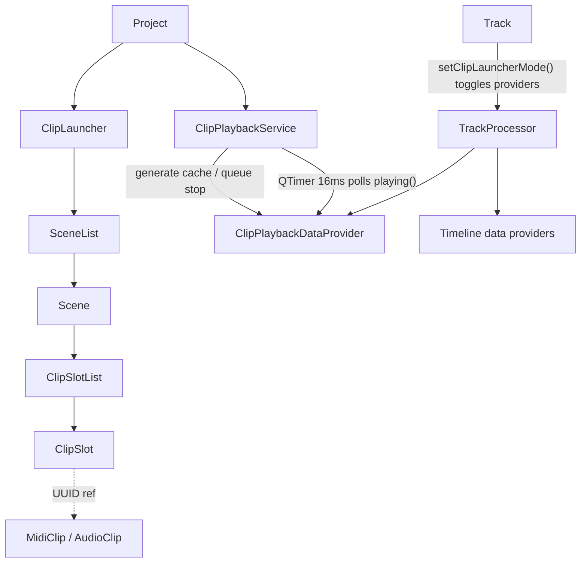

<!---
SPDX-FileCopyrightText: © 2026 Hannes Janetzek <hannes.janetzek@gmail.com>
SPDX-License-Identifier: CC-BY-SA-4.0
-->

# Zrythm Development & Investigation Notes

Running log of investigations and development work. Newest entries on top.

Build: Debug via Conan `gcc_debug` profile → `conanbuild/Debug`
(see [Build setup](#build-setup-2026-10-31) at the bottom).

---

## Clip Launcher: State of the Implementation (2026-10-31)

Snapshot at `1d50dc9d4` (v2.0.0-alpha.7). Based on reading the code and
running the existing unit tests (all 110 matching clip-launcher tests pass).
Items marked **(verified by reading)** are inferred from the code, not
reproduced in a test yet.

### Summary

The clip launcher is an **early prototype**: the data model, project
serialization, a basic grid UI and a working MIDI/audio playback path exist,
but quantization, stop handling, clip switching and most UI controls are
incomplete. The core playback logic was last changed substantially in
2025; since then it has mostly been touched by project-wide refactors
(Region→Clip rename, registry, pimpl).

| Area | Status |
|------|--------|
| Data model (ClipLauncher → Scene → ClipSlot) | Done, tested |
| Serialization (project JSON) | Done, tested (roundtrip + validation) |
| Track ↔ slot sync (track add/move/remove) | Done (`ClipSlotList` listens to `TrackCollection`) |
| Playback engine (`ClipPlaybackDataProvider`) | Works for basic loop playback; several bugs/gaps |
| Launch quantization | Only Immediate / NextBar / NextBeat; offset bug |
| Stop quantization | **Not implemented** (stops immediately) |
| Playback service / state machine | Basic; switching clips on a track is broken |
| UI grid | Present; several buttons unwired, debug placeholders |
| Undo/redo | Only "add clip to slot" via file import |
| Docs | `doc/dev/scenes_architecture.md` describes the intended design, partly ahead of the code |

### Architecture (as implemented)

Key files:

- Model: `src/structure/scenes/{clip_launcher,scene,clip_slot}.{h,cpp}`
- Service: `src/structure/scenes/clip_playback_service.{h,cpp}`
- RT playback: `src/structure/tracks/clip_playback_data_provider.{h,cpp}`
- Mode switch: `Track::setClipLauncherMode` (`src/structure/tracks/track.cpp:536`)
- Processor hook: `TrackProcessor::fill_midi_events` / `fill_audio_events`
  (`src/structure/tracks/track_processor.cpp:660`, `:691`)
- UI: `src/gui/qml/components/{ClipLauncherView,ClipSlotView,ClipLaunchButton}.qml`,
  shown from `CenterDock.qml` when `tracklistHeader.clipLauncherVisible`
- Undo: `src/commands/add_clip_to_clip_slot_command.h`
- Quantize enum: `ClipQuantizeOption` in `src/structure/tracks/track_fwd.h:84`

### What works

- One scene grid, rows = tracks (pinned/unpinned sections), columns = scenes,
  plus a "phantom" column that creates a scene on drop/double-tap.
- Dropping an audio/MIDI file on a slot imports it (undoable via
  `AddClipToClipSlotCommand`).
- Launch a clip / a whole scene; MIDI and audio clips loop over the clip
  length; all-notes-off is sent when a MIDI clip stops.
- Launching switches the track's processor from timeline providers to the
  clip launcher provider; the per-track "Switch Playback to Timeline"
  button switches back.
- Playback position indicator in the slot (polls the service at 60 fps).

### Bugs / gaps found

**Playback engine (`clip_playback_data_provider.cpp`)**

1. **Stop ignores quantization.** `queue_stop_playback()` clears the
   buffers immediately; the code says so in a comment ("In a full
   implementation, this would respect the quantization option").
2. **Quantized start lands at the block start, not on the bar or beat**
   **(verified by reading)**. `handle_quantization_and_start()` computes
   `output_buffer_timestamp_offset` (where the boundary falls inside the
   block) but only returns `{start_offset, samples_to_process}`; the
   caller then passes `time_nfo.buffer_offset_` to
   `process_chunks_with_looping`. When a bar or beat boundary falls inside
   a block, playback starts up to one block early and the clip's timing is
   off by that much from then on. The tests only cover boundaries that are
   exactly at a block start (`QuantizationTimingAccuracy`), so they don't
   catch this.
3. **Only Immediate, NextBar and NextBeat are implemented.**
   `NextQuarterBeat`…`NextThirtySecondBeat` fall into `default:` and start
   immediately.
4. **Switching clips on a playing track skips quantization and the
   restart (verified by reading).** `playing_` stays `true` when a new
   cache is installed, so the quantization branch is skipped: the new clip
   starts immediately, at the old clip's position, and wraps at the new
   clip's length.
5. **Looping ignores the clip's loop points.** The loop end is the clip
   length (`end_position_ = clip.length()`), and the loop always wraps to
   0. The clip-start, loop-start and loop-end markers are not used (see
   "Looping Behavior" in AGENTS.md). Whether
   `ClipRenderer::serialize_to_sequence` already applies the loop for MIDI
   is still to be checked.
6. **Tempo handling.** MIDI event times are converted with
   `tick_to_samples_rounded` at timeline ticks counted from 0, i.e. using
   the tempo at the start of the project rather than at the launch
   position. A tempo change partway through a clip, or a launch after a
   tempo change, gives wrong event timing (verified by reading). The loop
   length is converted the same way.
7. **Seeking before the launch point (verified by reading).**
   `update_playback_position` computes
   `(current - launch) % loop_end`. If the playhead moves before the
   launch position, the result is negative and is used as a buffer
   offset. The tests `BackwardPlayheadMovement*` exist, but they need
   checking for this case.
8. The playhead position is recalculated on every block, because
   `last_seen_timeline_position_` stores the block start, so it never
   equals the next block's start while rolling. This is harmless but
   wasteful. Behaviour while the transport is stopped hasn't been checked.

**Playback service (`clip_playback_service.cpp`)**

9. **Launching clip B on a track while clip A plays leaves A showing
   `Playing`.** `playing_clips_[track]` is overwritten and A's state is
   never reset. The new monitor also sees `playing() == true` right away
   and marks B `Playing` before its quantization point (see 4).
10. **The QTimer is destroyed inside its own `timeout` handler.** The
    monitor erases its own map entry, which owns the `QObjectUniquePtr<QTimer>`.
    It should use `deleteLater()` or stop the timer and defer the cleanup.
11. Raw `ClipSlot *` and `Track *` pointers are kept in
    `playing_clips_` and in the timer lambdas. Removing a scene or track
    while a clip plays leaves them dangling. They should be UUID
    references.
12. `checkPlaybackState()` is an empty stub, and
    `cancelPendingClipOperations` resets only queued clips, not playing
    ones.
13. `launchClip` defaults to `NextBar` and `stopClip` to `NextBar`, but
    a stop is immediate anyway (see 1), so the UI's "queued" state for a
    stop lasts only one timer tick.

**UI (`ClipLauncherView.qml` and related QML)**

14. The per-track **stop buttons** (`TrackStopButtonListView`) have no
    `onClicked`.
15. The header's global **"Switch Playback to Timeline"** button has no
    `onClicked`.
16. Scene headers show a hardcoded `"Scene " + (index + 1)` and ignore
    `scene.name` and `scene.color`. There's no UI to rename, delete,
    reorder or color scenes, although the model supports
    `removeScene`/`moveScene`.
17. Double-tapping an empty slot creates a MIDI clip with **two
    hardcoded test notes** (pitches 64 and 68) and logs to the console.
    This is debug code, and it bypasses undo
    (`addEmptyMidiClipToClip` calls `setClip` directly).
18. The quantize menu offers only Immediate, Bar and Beat. There's no
    global or per-clip default launch quantization setting.
19. There's no stop-scene button, though the service has `stopScene`.
20. There's no way to open a slot clip in the editor (piano roll or
    audio editor) from the launcher; this needs checking.
21. QML style issues: `MouseArea` is used for right-click (rule: pointer
    handlers), and the header labels are not translatable (`"Scene "`,
    `"Stop " + name`).

**Undo / model**

22. Adding a scene, removing or moving scenes, the double-tap clip
    creation, and switching track mode are not undoable.
23. Scene `name` and `color` exist in the model and are serialized, but
    nothing sets them in the UI.

### Not implemented at all (per the "Future Enhancements" section of `doc/dev/scenes_architecture.md`)

Follow actions, scene launch quantization, clip envelopes, MIDI/controller
mapping, recording into slots, warping for launcher clips, launch modes
(trigger/gate/toggle), legato.

### Test coverage

- `tests/unit/structure/scenes/`: model, serialization and service (the
  service tests are mostly state checks).
- `tests/unit/structure/tracks/clip_playback_data_provider_test.cpp`: 31
  tests (looping, boundary quantization, audio, all-notes-off).
- `tests/unit/commands/add_clip_to_clip_slot_command_test.cpp`.
- Missing: a quantization boundary inside a block (bug 2), switching
  clips on a playing track (4/9), tempo changes (6), quantized stop (1),
  and any integration or QML test of the launcher view.

### Suggested next steps (rough priority)

1. Fix the quantized-start offset (2) and add a test with the boundary
   inside a block.
2. Fix clip switching on a track (4 and 9): queue the new clip until the
   quantization point, and reset the previous slot's state.
3. Implement quantized stop (1), sharing the boundary maths with the
   start path, and add the finer quantize values (3).
4. Make the service robust: UUID references (11), safe timer teardown
   (10), and reset playing slots on mode switch (12).
5. UI: wire the stop and switch buttons (14, 15), use scene names (16),
   remove the debug notes (17), and add scene management and undo
   (16, 22).
6. Respect the clip loop points and tempo (5, 6).

---

## Build setup (2026-10-31)

- Tools: Conan 2.33 in `venv/` (gitignored); profiles installed into
  `~/.conan2`; local recipe remote `ext/conan-center-index`.
- Profile `gcc_debug` (GCC 16.2; the clang profile pins clang 22, while
  the system has 23).
- Command used:
  `conan install . -pr:h gcc_debug -pr:b gcc_debug --build=missing -c:b 'yasm/*:tools.build:cflags+=["-std=gnu17"]'`,
  then `cmake --preset default` and
  `cmake --build conanbuild/Debug --config Debug`.
- Problems hit along the way:
  - The Conan system check for `xorg/system` needs `libxres` (installed
    with pacman).
  - yasm 1.3.0 fails under GCC 16's default C23 (`false` and `true`
    became keywords), so it's built with `-std=gnu17`. yasm is a build
    tool, so it needs `-c:b`, not `-c`.
  - The CPM dependency `loop-tempo-estimator` uses Git LFS, so
    `git-lfs` must be installed.
- Run: `source conanbuild/Debug/generators/conanrun.sh && ./conanbuild/Debug/products/bin/zrythm`
- System Qt (6.12) isn't usable: there's no QtCanvasPainter, the project
  targets 6.11 and uses private Qt API, and the Qt recipe is patched.
- Wayland: the UI runs natively on Wayland. Plugin editors still need
  X11, which Zrythm provides through XWayland
  (`src/gui/backend/project_manager.cpp:162`).
